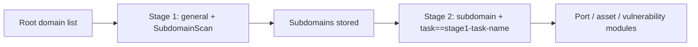

---

## name: scopesentry-mcp
description: Manage the security scanning platform (projects, tasks, templates, assets, nodes) through ScopeSentry MCP. Use when the user mentions ScopeSentry, MCP, API keys, scan tasks, or asset queries.

# ScopeSentry MCP Guide

For users with an **existing ScopeSentry deployment**. Connect through Cursor or another MCP client; no local source checkout is needed.

## 1. Preparation

### 1.1 Confirm service access

- Default web interface: `http://<主机>` (replace the placeholder with your host)
- MCP endpoint: `http://<主机>/mcp` (use the actual `/mcp` address if a reverse proxy or frontend proxy is present)

### 1.2 Create an API key

1. Sign in to the ScopeSentry web interface.
2. Create a key on the **API Key** management page, or through the interface supplied by the administrator.
3. Save the returned `ssk_...` string; it is **shown only once**.

### 1.3 Configure Cursor MCP

Cursor → Settings → MCP → Add server:

```json
{
  "mcpServers": {
    "scopesentry": {
      "url": "http://<你的主机>:8082/mcp",
      "headers": {
        "X-API-Key": "ssk_你的密钥"
      }
    }
  }
}
```

Alternatively, use `Authorization: Bearer ssk_你的密钥` (replace the placeholder with your key).

Restart MCP or reload Cursor after configuration. Confirm that tools such as `list_projects` and `list_assets` appear.

---

## 2. Tool overview

| Tool | Purpose |
| --- | --- |
| `list_projects` | Project tree grouped by tag, including project IDs |
| `list_projects_data` | Paginated project list with name search |
| `get_project` | Project details |
| `create_project` | Create a project |
| `list_tasks` | Scan task list |
| `get_task` | Task details |
| `list_scan_templates` | Scan template list |
| `get_scan_template` | Template details |
| `list_plugin_modules` | Scan pipeline module names |
| `list_plugins` | Available plugins, including hashes and default parameters |
| `create_scan_template` | Create a scan template |
| `create_scan_task` | Create a scan task |
| `list_assets` | Query asset types with pagination |
| `count_assets` | Count assets (`/api/assets/common/total`) |
| `get_asset_detail` | Asset or finding details |
| `add_asset_tag` | Add an asset tag |
| `list_nodes` | Scan node list |

The MCP tool descriptions (schemas) define the parameters. `list_assets` and `count_assets` use the same search/filter syntax; read the `list_assets` description before querying assets.

Use `count_assets` for a total count (the web pagination total endpoint), rather than repeatedly paginating `list_assets` just to count records.

---

## 3. Common workflows

### 3.1 Query assets by project

When the user or context **already specifies a project**, prefer `filter.project` to narrow the query and avoid slow responses from excessive cross-project data. A project filter is not mandatory when no project is specified.

1. Use `list_projects` or `list_projects_data` to obtain the project's **ObjectID** (`id` / `children[].value`).
2. Pass it as `filter.project` to `list_assets`; **use the ID, not the project's Chinese display name**.

```json
{
  "asset_type": "asset",
  "pageIndex": 1,
  "pageSize": 20,
  "search": "domain=^example.com",
  "filter": {
    "project": ["<项目ObjectID>"]
  }
}
```

### 3.2 Create a scan task

1. Use `list_nodes` to get online node names.
2. Use `list_scan_templates` or `create_scan_template` to obtain a template **ObjectID**.
3. For `create_scan_task`, `name` and `node` are required; `template` takes the template ID, not its name.

**Target source `targetSource` (same as the web interface):**

| targetSource | Meaning | Required parameters |
| --- | --- | --- |
| `general` | Direct target input | `target` |
| `project` | Read targets from projects | `project` (array of project ObjectIDs) |
| `asset` | Search the web asset inventory | `search`; optional `project`, `filter`, `targetNumber` |
| `RootDomain` | Search root domains | `search`; optional `project`, `filter`, `targetNumber` |
| `subdomain` | Search subdomains | `search`; optional `project`, `filter`, `targetNumber` |
| `UrlScan` | Search URL scan results | `search`; optional `project`, `filter`, `targetNumber` |
| `*Source` (such as `subdomainSource`) | Create from selected/searched assets on an asset page | `search` when `targetTp=search`; `targetIds` when `targetTp=select` |

**Example: scan root domains directly:**

```json
{
  "name": "example-子域名收集",
  "node": ["node-1"],
  "template": "<模板ObjectID>",
  "targetSource": "general",
  "target": "example.com\nfoo.com",
  "project": ["<项目ObjectID>"]
}
```

**Example: continue from the subdomain inventory, filtering by the previous task name:**

```json
{
  "name": "example-端口与漏洞",
  "node": ["node-1"],
  "template": "<后续模块模板ObjectID>",
  "targetSource": "subdomain",
  "search": "task==\"example-子域名收集\"",
  "project": ["<项目ObjectID>"]
}
```

### 3.3 Complete root-domain reconnaissance (two stages recommended)

For **root-domain input** and **complete reconnaissance**, use two scans rather than running the entire pipeline at once.

**Reason:** distributed tasks are assigned by individual target. When a root domain is assigned to one node, the subdomains discovered there also run subsequent modules on that node, which can cause uneven load, slowness, and errors.

**Recommended procedure:**

1. **Stage 1: subdomain collection only.** Set `targetSource` to `general` and `target` to all root domains, one per line. Enable only `SubdomainScan` and `SubdomainSecurity` (subdomain scanning and takeover) in the template. Wait for completion using `get_task`.
2. **Stage 2: subsequent modules.** Set `targetSource` to `subdomain`; use `search` with an exact `task=="<stage-1-task-name>"` match and optionally narrow with `project`. Use a template for port scanning, asset mapping, vulnerability scanning, etc., optionally excluding SubdomainScan. Subdomains are distributed individually across nodes for better parallelism.

The equivalent web workflow is to filter the Subdomains asset page by task name and choose Create task from subdomains.



### 3.4 Create a scan template

1. `list_plugin_modules` → module names.
2. `list_plugins`, optionally filtered by `module` → each plugin's `hash` and default `parameter`.
3. `create_scan_template` → specify module-to-plugin-hash arrays in `modules`.

---

## 4. Asset queries (`list_assets` / `count_assets`)

`count_assets` takes the same `asset_type`, `search`, and `filter` as `list_assets`, returning `{ "total": N }`; it corresponds to `/api/assets/common/total` in the web interface.

```json
{
  "asset_type": "subdomain",
  "search": "task==\"某任务名\"",
  "filter": {"project": ["<项目ObjectID>"]}
}
```

**Performance guidance for both tools:** prefer `filter.project` when a project is known. For indexed fields in `search`, prefer exact `==` or prefix `^` matching (see [4.3](#43-search-expressions)) to broad fuzzy `=` queries that slow responses. Do not require a project filter without project context.

See [4.4](#44-exact-filtering) for asset types supporting `filter.project`.

### 4.1 Asset types: `asset_type`

`asset`, `RootDomain`, `subdomain`, `app`, `mp`, `UrlScan`, `SensitiveResult`, `DirScanResult`, `crawler`, `vulnerability`, `PageMonitoring`, `IPAsset`, `SubdomainTakerResult`

Example aliases: `web`→asset, `vuln`→vulnerability, `ip`→IPAsset, `url`→UrlScan.

### 4.2 Parameters

| Parameter | Meaning |
| --- | --- |
| `pageIndex` / `pageSize` | Pagination, default 1 / 20 |
| `search` | Search expression (below) |
| `filter` | Exact-filter JSON (below) |
| `sort` | Only UrlScan and DirScanResult support sorting by `length` |
| `sid` | SensitiveResult only: sensitive-data rule name |

`search` and `filter` **can be combined**.

### 4.3 Search expressions

Custom DSL (**not SQL**):

| Operator | Meaning | Index use | Example |
| --- | --- | --- | --- |
| `=` | Fuzzy matching (regex) | No index | `domain=example` |
| `==` | Exact equality | **Uses index** | `port==443` |
| `!=` | Exclusion | — | `port!="80"` |
| `&&` | AND | — | `domain==example.com && port==443` |
| `||` | OR | — | `title=admin || body=login` |

**Indexes and operators:** fields including `domain`, `ip`, `port`, and `title` are indexed, but only **exact `==`** or **prefix matching with a value beginning with `^`** (for example, `domain=^example.com`) can use the index. **`=` becomes a fuzzy regex match without index use**, which can be slow on large datasets.

**Common search fields for all types:** `tag`, `task` (task name), `rootDomain`.

**Do not put project in search**: it is invalid or errors when combined with `&&`. Use `filter.project`.

**Common search fields by type:**

| asset_type | Fields |
| --- | --- |
| asset | domain, ip, port, service, app, title, statuscode, icon, banner, type, body, header |
| RootDomain | domain, icp, company |
| subdomain | domain, ip, type, value |
| app | name, icp, company, category, description, url, apk |
| mp | name, icp, company, category, description, url |
| UrlScan | url, input, source, resultId, type |
| SensitiveResult | url, sname, body, info, md5 |
| DirScanResult | url, statuscode, redirect, length |
| vulnerability | url, vulname, matched, request, response, level |
| crawler | url, method, body, resultId |
| PageMonitoring | url, hash, diff, response |
| IPAsset | ip, domain, port, service, webServer, app |
| SubdomainTakerResult | domain, value, type, response |

**Search examples:**

- `domain==www.example.com && port==443` (exact, indexed)
- `domain=^example.com` (prefix, indexed)
- `ip==192.168.1.1`
- `task=="某任务名"` (replace with the task name)
- `level==high` (vulnerability)
- `statuscode==200` (DirScanResult)

Use `=` only for fuzzy containment, for example `title=admin`; because it does not use an index, narrow the query with project or other conditions.

### 4.4 Exact filtering

JSON object: multiple values under one key are **OR**; different keys are **AND**.

**Prefer project when known:** if the user/context specifies a project and asset_type supports `project`, include it to narrow the query. Do not require it when no project information exists.

| filter key | Meaning | Values |
| --- | --- | --- |
| `project` | Owning project | **ObjectID** from `list_projects` / `list_projects_data` |
| `task` | Source task | **Task name**, from `name` in `list_tasks` |
| `port` | Port | For example, `"443"` |
| `service` | Service/protocol | For example, `"https"` |
| `app` | Application fingerprint | For example, `"Nginx"` |
| `icon` | Icon hash | |
| `statuscode` | HTTP status code | Mainly for asset |
| `status` | State | UrlScan/DirScan HTTP code; finding/sensitive-data handling status |
| `level` | Finding severity | critical / high / medium / low / info |
| `type` | Type | For example, subdomain record types A, CNAME |
| `color` | Sensitive-data rule color | SensitiveResult |
| `sname` | Sensitive-data rule name | SensitiveResult |
| `tags` | Tags | |

**Available filter keys by type:**

| asset_type | filter key |
| --- | --- |
| asset | project, port, service, app, icon, statuscode, type, task, tags |
| RootDomain | project, tags |
| subdomain | project, type, task, tags |
| app / mp | project, tags |
| UrlScan | status, tags |
| DirScanResult | status, tags |
| SensitiveResult | status, color, sname, tags |
| crawler | project, task, tags |
| vulnerability | project, level, status, task, tags |
| PageMonitoring / SubdomainTakerResult | tags |
| IPAsset | project, port, service, app |

**Filter example:**

```json
{"project": ["<项目ObjectID>"], "port": ["443"]}
```

**Combined query example:**

```json
{
  "asset_type": "asset",
  "search": "domain=^baidu && port==443",
  "filter": {"project": ["<项目ObjectID>"]},
  "pageIndex": 1,
  "pageSize": 10
}
```

**Notes:**

- Prefer `filter.project` when project context exists and the type supports it; otherwise it is optional.
- Do not put the project's display name in `filter.project`.
- Use `==` for known values and `^` for prefixes; avoid excessive fuzzy `=` searches on large tables.
- Use `filter.status` for UrlScan HTTP status; DirScanResult supports `statuscode==200` in search.
- For SensitiveResult rule names, use `sname=规则名` in search (replace the rule-name placeholder), or `filter.sname`.

### 4.5 Sorting: sort

Only **UrlScan** and **DirScanResult** support:

```json
{"length": "ascending"}
```

Other types ignore `sort` and use their default time order.

---

## 5. Scan template module names

`TargetHandler`, `SubdomainScan`, `SubdomainSecurity`, `PortScanPreparation`, `PortScan`, `PortFingerprint`, `AssetMapping`, `AssetHandle`, `URLScan`, `WebCrawler`, `URLSecurity`, `DirScan`, `VulnerabilityScan`, `PassiveScan`

---

## 6. Troubleshooting

| Symptom | Resolution |
| --- | --- |
| No MCP tools | Check URL, API key, and whether ScopeSentry is running |
| 401 / 403 | Recreate or replace the API key |
| Assets not found | Verify `filter.project` is an ObjectID; do not put project in search |
| Template/task creation fails | `template` must be a template ObjectID; `node` must contain online node names |
| Query is slow/stuck | Add `filter.project` when known; use `==` or prefix `^` on indexed search fields instead of `=`; reduce `pageSize` |

---
